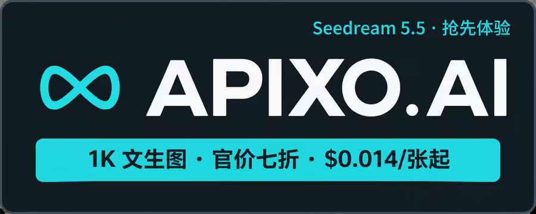
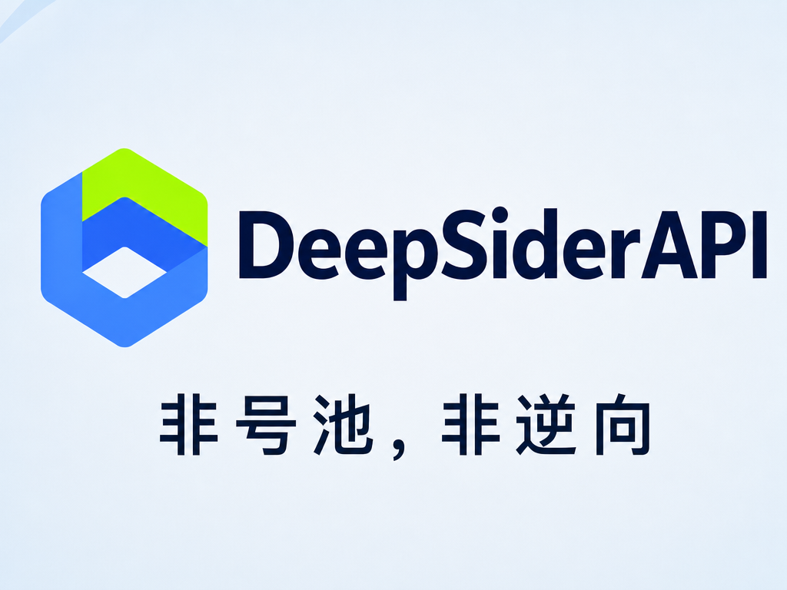
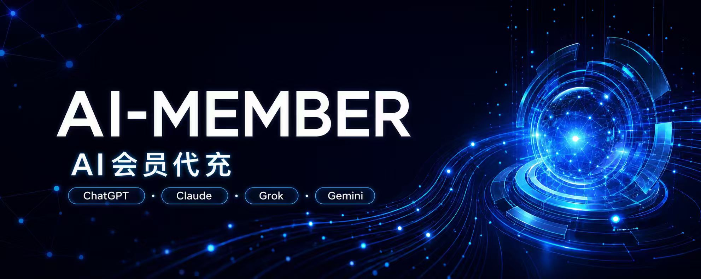

::: tip 最后核对
赞助信息最后核对日期：2026-09-11。本页展示的赞助项目、价格、可用性、服务条款和售后政策请以赞助商官方页面为准。
:::

# 赞助商 {.sponsors-page-title}

感谢以下项目和服务支持 CodexGuide 的持续建设。赞助信息用于帮助读者了解相关服务，具体价格、可用性、服务条款和售后政策请以赞助商官方页面为准。感谢<a href="https://www.packyapi.ai/register?aff=CV0c" target="_blank" rel="noopener noreferrer">packyapi</a>的独家赞助

  <a class="sponsor-card" href="https://getgpt.pro/i/codexguide" target="_blank" rel="noopener noreferrer">
    
    <strong>GetGPT Pro</strong>
    提供 ChatGPT、Claude 等 AI 订阅开通与充值服务，支持自助下单、快速到账与售后支持。
  </a>
  

    <a class="sponsor-primary-link" href="https://apixo.ai/?utm_source=github&utm_medium=sponsorship&utm_campaign=github_readme&utm_content=freestylefly_codexguide" target="_blank" rel="noopener noreferrer">
      
      <strong>APIXO：一站式 AI 图片与视频创作平台</strong>
    </a>
    APIXO 汇集多款 AI 图片与视频模型，无需编程，打开网页即可创作；也支持通过 API 接入自己的应用与自动化工作流。<a href="https://apixo.ai/models/seedream-5-5?utm_source=github&utm_medium=sponsorship&utm_campaign=github_readme&utm_content=freestylefly" target="_blank" rel="noopener noreferrer">Seedream 5.5</a> 抢先体验，1K 文生图仅 $0.014/张起，享官价七折优惠。<b>优惠自动生效，无需优惠码，让更多创意轻松落地。</b>
    <a class="sponsor-action-link" href="https://apixo.ai/?utm_source=github&utm_medium=sponsorship&utm_campaign=github_readme&utm_content=freestylefly_codexguide" target="_blank" rel="noopener noreferrer">探索 APIXO 模型与优惠</a>
    活动截至北京时间 2026 年 12 月 31 日 23:59。
  

  <a class="sponsor-card" href="https://apimart.ai/register?aff=oQgzUQ" target="_blank" rel="noopener noreferrer">
    
    <strong>APIMart</strong>
    专注 AI 图片和视频生成的低价 API 平台，提供统一异步 API，支持按量付费且无月费。
  </a>
  <a class="sponsor-card" href="https://www.deepsiderapi.com/?utm_source=CodexGuide" target="_blank" rel="noopener noreferrer">
    
    <strong>Deepsider API</strong>
    Deepsider API 提供了 GPT、Claude、Gemini、DeepSeek 等主流模型的 API 接入服务。非号池，非逆向，大厂官方渠道。支持按量计费与实时用量监控，方便为你的自动化工作流接入 AI。
  </a>
  

    <a class="sponsor-primary-link" href="https://www.ai-member.icu?from=4068" target="_blank" rel="noopener noreferrer">
      
      <strong>AI-MEMBER 会员代充</strong>
    </a>
    AI-MEMBER 面向个人用户、开发者与团队，提供 ChatGPT Plus+Pro充值、Claude Pro、Gemini Pro、Gork Super 等正价会员代充服务。
    <a class="sponsor-action-link" href="https://www.ai-member.icu?from=4068" target="_blank" rel="noopener noreferrer">查看教程</a>
  

  <a class="sponsor-card" href="https://pptoken.cc/" target="_blank" rel="noopener noreferrer">
    
    <strong>PPToken</strong>
    提供 ChatGPT、Claude、Gemini 等主流 AI 模型 API 中转与密钥分发服务，支持低延迟、高可用、按量计费与订阅套餐。
  </a>
  <a class="sponsor-card" href="https://unity2.ai/register?source=canghe" target="_blank" rel="noopener noreferrer">
    <strong>Unity2.ai</strong>
    社区赞助入口，更多服务信息请以赞助商官方页面为准。
  </a>
  <a class="sponsor-card" href="https://payforchat.com/register?ref=XJKHTC7N" target="_blank" rel="noopener noreferrer">
    <strong>PayForChat</strong>
    社区赞助入口，更多服务信息请以赞助商官方页面为准。
  </a>
  <a class="sponsor-card" href="https://muskapi.com/register?utm_source=codexguide&utm_medium=website" target="_blank" rel="noopener noreferrer">
    <strong>Muskapi</strong>
    社区赞助入口，更多服务信息请以赞助商官方页面为准。
  </a>
  

    
    <strong>二狗 API</strong>
    接入二狗，稳如老狗。<a href="https://ergouapi.com/r/gh-codexguide" target="_blank" rel="noopener noreferrer">二狗 API</a> 中转站，全站 0.1x～0.2x 超低倍率，提供 Claude / GPT / Grok 等多个国内外 100% 纯血大模型接口。  顶级 IPLC 线路 + 住宅双 ISP 冗余，确保全国范围稳定低延迟访问。欢迎各位开发者、工作室 <a href="https://ergouapi.com/r/gh-codexguide" target="_blank" rel="noopener noreferrer">注册使用</a>。
  

## 成为赞助商

如果你希望支持 CodexGuide，请在微信中搜索并关注公众号 **苍何**，留言 **商务合作**，并附上产品名称、官网链接和赞助说明。商务联系与付费交流群相互独立，无需先购买入群资格。
